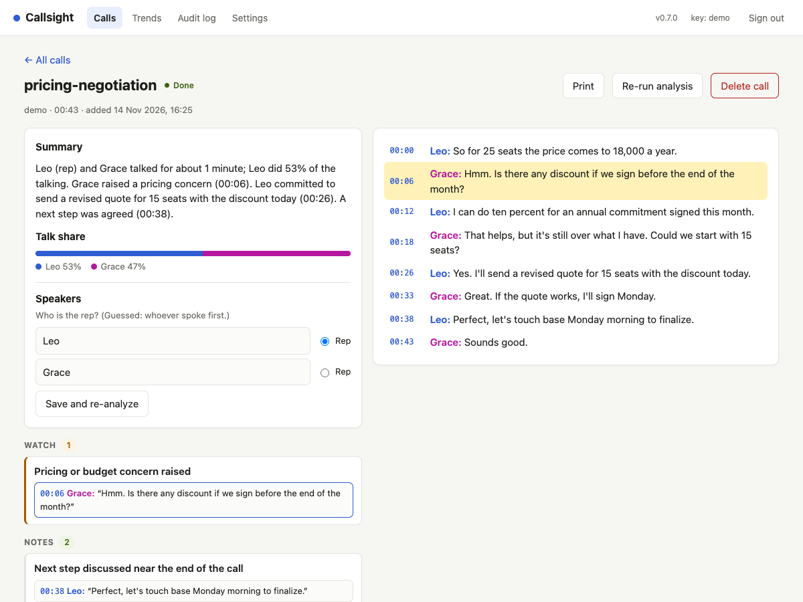

# Callsight

Self-hostable, open-source conversation intelligence for sales and customer calls.
Feed it a call, get back a summary and flagged risks (pricing objections, competitor
mentions, no next step, rep talking too much), with every insight linked to the exact
transcript lines that support it.

> **Status: v0.7.0, early.** Text and audio calls, rule-based and local-LLM analysis, a web
> UI, a webhook connector, API keys with per-organization separation, single sign-on with admin
> roles, and an audit log all work and are tested. Speaker separation for mono recordings and
> search by meaning are opt-in (see below). Not yet: telephony/meeting connectors. It has only
> been measured on synthetic calls so far. Run it behind a reverse proxy for TLS and rate
> limiting. See the [roadmap](docs/roadmap.md).



## Why

Conversation-intelligence tools are sold per seat and keep your recordings on someone
else's servers. The software around the models is the replaceable part. Callsight aims
to be a self-hosted alternative where you choose the models and keep the data. Today that means
local models through Ollama; nothing leaves your servers.

*Pricing and existing open-source projects have been surveyed; whether buyers want this has
not been validated with users yet ([interview kit](docs/interview-kit.md)).*

## What works today

| Capability | State |
|---|---|
| Parse text transcripts (`[mm:ss] Speaker: text`) | Working, tested |
| Rule-based analyzers: talk ratio, pricing/timing objections, competitor mentions, next step, action items | Working, tested |
| Evidence links (segment id, timestamp, speaker, quote) on every insight | Working, tested |
| Optional LLM summary via local Ollama | Run against a live Ollama (llama3.1 8B and llama3.2:3b) during the evals; the summary text itself is not scored |
| CLI and HTTP API (`/health`, `POST /v1/analyze`, `GET /v1/calls`, `GET /v1/calls/{id}`) | Working, tested |
| Postgres persistence (calls, segments, insights with evidence) when `CALLSIGHT_DATABASE_URL` is set | Working, tested against Postgres 16 (`CALLSIGHT_TEST_DATABASE_URL=... pytest`) |
| Audio: `POST /v1/calls/upload` → MinIO → background worker (faster-whisper, speakers split by stereo channel) → stored report | Working, tested: full stack verified with a real 2-min stereo call (about 50 s to transcribe on CPU in Docker) |
| `docker-compose.yml` (Postgres+pgvector, MinIO, API, worker, optional Ollama) | `db`, `minio`, `api` and `worker` built and run. MinIO is Chainguard's build (`minio/minio` is no longer published), pinned by digest |
| Web UI at `/`: upload, paste, call list, transcript with click-to-jump evidence and audio seek | Working; checked in headless Chrome against real calls |
| Webhook connector (`POST /v1/orgs/{org}/connectors/generic/webhook`, HMAC-signed per org; transcript or https recording URL) | Working, tested (SSRF guard, signatures, worker fetch) |
| API keys, organizations (each key sees only its org's calls), audit log (`GET /v1/audit`) | Working, tested including cross-org access attempts |
| LLM analyzer `llm_insights` (objection types incl. authority/need, commitments, next step, sentiment shifts) with an eval harness | Working; see [evals/README.md](evals/README.md) for measured precision/recall |
| Single sign-on (any OIDC provider), allowed email domains, admin roles (manage keys, domains and admins in the UI) | Working, tested; sign-in checked end to end in a browser against Dex, a real OIDC server |
| Trends dashboard, bulk re-analysis, CSV export, printable summary, rule-based recap | Working, tested |
| Mono-recording speaker separation (pyannote, opt-in) | Working; checked on synthetic calls only, in the venv and in the Docker image (see below) |
| Semantic search across calls ("Meaning" on the Calls page, `GET /v1/search`, opt-in) | Working, tested; checked with `mxbai-embed-large` on the 30 eval calls (see below) |
| Telephony/meeting connectors | Not started |

## Try it (no dependencies beyond Python 3.10+)

```bash
cd services/api
PYTHONPATH=src python -m callsight analyze ../../examples/sample_call.txt --competitor AcmeCall
PYTHONPATH=src python -m callsight analyze ../../examples/sample_call.txt --json
```

Run the tests:

```bash
cd services/api
pip install -e ".[dev]"
python -m pytest              # unit tests; Postgres/MinIO tests are skipped

# Full suite, as CI runs it (needs Docker):
../../scripts/test-services.sh up && eval "$(../../scripts/test-services.sh env)"
python -m pytest
../../scripts/test-services.sh down
```

## Quick start (about 2 minutes)

```bash
docker compose up --build -d
docker compose exec api python -m callsight.admin demo
```

The second command loads six example calls into a `demo` organization and prints an API key.
Open http://localhost:8000, paste the key, and click any insight's quote to jump to the line.

## Run the stack

For a production deployment (TLS, backups, upgrades) see [docs/deployment.md](docs/deployment.md).

```bash
cp .env.example .env          # then change the passwords and set CALLSIGHT_SECRET_KEY
docker compose up --build     # API on http://localhost:8000
docker compose --profile local-llm up   # also start Ollama (set CALLSIGHT_LLM_PROVIDER=ollama)

# Create an API key (the org is created if it does not exist; the key is shown once):
docker compose exec api python -m callsight.admin create-key --org acme --name alice
```

Open http://localhost:8000, enter the key, then upload recordings, paste transcripts and browse
calls. Clicking an insight's quote jumps to that line and plays the recording from there.

```bash
curl -s localhost:8000/v1/analyze -H "Authorization: Bearer $KEY" -H 'content-type: application/json' \
  -d '{"call_id":"demo","transcript":"[00:00] Alex: Hi\n[00:10] Priya: The price is too expensive."}'
```

### Access control

- **Single sign-on (OpenID Connect).** People sign in to the web UI with their company account
  from any OIDC provider (Google Workspace, Microsoft Entra ID, Okta, Auth0, Keycloak, Authentik):
  1. Register callsight with the provider. Redirect URI: `<CALLSIGHT_PUBLIC_URL>/auth/callback`;
     scopes: `openid email profile`.
  2. Set `CALLSIGHT_OIDC_ISSUER`, `CALLSIGHT_OIDC_CLIENT_ID`, `CALLSIGHT_OIDC_CLIENT_SECRET`,
     `CALLSIGHT_PUBLIC_URL` and `CALLSIGHT_SECRET_KEY`.
  3. Allow your email domain: `python -m callsight.admin allow-domain --org acme --domain acme.com`.

  Only **verified** emails at an allowed domain get in. Some providers don't send
  `email_verified` by default (check Microsoft Entra ID's optional claims); callsight refuses
  those sign-ins until it is sent. Sessions last 8 hours in an HttpOnly, SameSite=Lax cookie
  (Secure when `CALLSIGHT_PUBLIC_URL` is https, which it must be in production).
  `disallow-domain` ends that domain's sessions immediately. API keys keep working for
  scripts and integrations.
- **Organizations and keys.** Every API key belongs to one organization and can only see and
  create that organization's calls; another org's call returns 404. Keys are stored as
  SHA-256 hashes and can be revoked: `python -m callsight.admin revoke-key --org acme --name alice`.
- **Admins.** Admins manage access from *Settings → Access*: create and revoke API keys, remove
  sign-in domains, and make other signed-in people admins. Everyone else sees it read-only.
  Create the first admin on the server, with an admin key
  (`create-key --org acme --name alice --admin`) or an SSO email
  (`grant-admin --org acme --email alice@acme.com`). Adding a sign-in domain stays on the
  server (`allow-domain`), because a domain decides who joins. Existing keys are members.
  All other features are open to every member.
- **Audit log.** Creating or reading a call, playing its recording, and every access change
  are recorded with who did it: `GET /v1/audit` (or *Audit log* in the UI).
- **Recordings** are played through short-lived signed links (6 hours) because audio players
  cannot send an API key. Set `CALLSIGHT_SECRET_KEY` so links survive restarts and work across
  API replicas.
- **Settings per organization.** Competitor names to flag are kept per org on the *Settings*
  page (`GET`/`PUT /v1/settings`); `CALLSIGHT_COMPETITORS` adds names for every org.
- **Speakers and re-analysis.** On a call page, rename speakers ("Speaker 1" -> "Alex") and mark
  the rep; saving re-analyzes the call (`PUT /v1/calls/{id}/speakers`). *Re-run analysis*
  (`POST /v1/calls/{id}/reanalyze`) applies the current competitor list, rules and LLM to an
  older call.
- **Trends.** The *Trends* page (`GET /v1/trends?days=30`) shows patterns across finished calls:
  how many raised each issue, competitors mentioned, calls per week, the share ending without a
  next step, and the calls that need attention most.
- **Export and bulk re-analysis.** *Export CSV* on the call list (`GET /v1/export/calls.csv`, same
  search/status filters, plus `days`) gives one row per insight with its evidence; cells that
  would run as spreadsheet formulas are defused. *Re-analyze all calls* on the Settings page
  (`POST /v1/reanalysis`, progress via `GET`) applies current settings to every finished call in
  the background. *Print* on a call page gives a clean one-page summary.
- **Deleting data.** `DELETE /v1/calls/{id}` (or *Delete call* in the UI) removes the call, its
  transcript, insights and recording from storage. `CALLSIGHT_RETENTION_DAYS=90` makes the worker
  delete calls older than 90 days, checked hourly. The audit log keeps a record that a deletion
  happened, but not the deleted content.
- Without a database, `POST /v1/analyze` is a stateless open endpoint (nothing is stored).
- **Request limits.** Uploads may be up to 500 MB and other requests up to 10 MB, enforced while
  the body streams in. Uploads are authenticated before any of the body is read. Rate limiting
  is left to the reverse proxy, because behind a proxy every client shares one address.

### Mono recordings: separating speakers (opt-in)

Stereo phone recordings already get one speaker per channel. Mono recordings (Zoom, Meet,
Teams exports) are one speaker unless diarization is on. With it, [pyannote](https://github.com/pyannote/pyannote-audio)
finds who spoke when and each transcribed word is given to the speaker talking at that moment.

1. Accept the model's terms (free account) at https://huggingface.co/pyannote/speaker-diarization-community-1
   and create a read-only token.
2. Build the image with CPU-only PyTorch and pyannote (1.9 GB, against 0.6 GB without):
   `docker compose build --build-arg EXTRAS=asr,diarize`
3. Set `CALLSIGHT_DIARIZATION=pyannote` and `HF_TOKEN=<token>`, then start the worker.

Speakers come out as "Speaker 1", "Speaker 2", ... in order of first speaking; rename them
and mark the rep on the call page.

Diarization runs on top of transcription. On a 10-core Apple M4 CPU it took 0.6–0.7× the call's
length, against about 0.15× for Whisper `small`. In Docker with 4 CPUs, a 90-second clip took 69 s
to transcribe and diarize. On two-party test calls made with synthetic voices,
99.7–99.9% of words went to the right speaker, including with phone-band audio and background
noise. Two similar-sounding voices were merged into a single speaker, which leaves the call as it
would be without diarization. These calls have no crosstalk, so try it on a few of your own
recordings before relying on it.

### Searching calls by meaning (opt-in)

The Calls page searches call names and exact words. With semantic search on, a **Meaning**
switch next to the search box finds lines that say the same thing in other words: "they need
their boss to approve it" finds "my director would have to approve any new tool" and "I'd need to
run this by my VP". Each result opens the call at that line.

1. Start Ollama (`docker compose --profile local-llm up`) and pull an embedding model:
   `docker compose exec ollama ollama pull mxbai-embed-large`
2. Set `CALLSIGHT_EMBED_MODEL=mxbai-embed-large` for the API and worker.

The worker indexes every finished call, existing ones included, whenever it has no recording to
transcribe; the page says how many calls are still waiting. On CPU in Docker it indexed about 7
lines a second, so a large backlog takes a while the first time. Changing the model re-indexes
everything. Search itself took 60–340 ms per query.

On the 30 labelled eval calls, plain-English queries found the right lines well for pricing,
approval and "we don't need this", less well for timing, and poorly for competitor names; use the
word search for names. `mxbai-embed-large` did better there than `nomic-embed-text` (40% against
27% of the top 5 results being labelled lines). Results are ranked by closeness and always fill
the list, so the last ones can be off topic.

### Sending calls from another system (webhook)

Each organization has its own webhook secret and URL:
`python -m callsight.admin webhook-secret --org acme` prints both. POST JSON signed with
HMAC-SHA256 of the raw body:

```bash
BODY='{"call_id":"crm-123","recording_url":"https://files.example.com/calls/123.mp3"}'
SIG=$(printf %s "$BODY" | openssl dgst -sha256 -hmac "$WEBHOOK_SECRET" | sed 's/^.* //')
curl -s "localhost:8000/v1/orgs/$ORG_ID/connectors/generic/webhook" -H "X-Callsight-Signature: sha256=$SIG" -d "$BODY"
```

Send `transcript` instead of `recording_url` to analyze text right away. Recording URLs must
be https and must resolve to public addresses; the worker downloads them into storage.
New connectors implement `parse(body, headers)` and register under kind `connector`
(see `callsight/connectors.py`).

## How it is organised

```
services/api/src/callsight/
  models.py        Transcript, Segment, Insight, Evidence, CallReport
  interfaces.py    ASR / LLM / Analyzer protocols (the plugin contracts)
  registry.py      register("analyzer", "name") plugin registry
  providers/       text transcript parser, Whisper (audio), Ollama LLM
  analyzers/       rule-based baseline analyzers, LLM analyzer (llm_insights)
  pipeline.py      transcript -> analyzers -> optional LLM summary -> report
  service.py       entry point shared by CLI, API and worker
  store.py         Postgres persistence, job queue, audit log (all queries scoped by org)
  migrations/      numbered SQL migrations, applied at startup
  auth.py          API keys, orgs, signed recording links
  connectors.py    inbound webhook connectors
  worker.py        background transcription/analysis of recordings
  evals.py         precision/recall harness (python -m callsight eval)
  static/          the web UI (one HTML file, no build step)
  cli.py, api.py, admin.py   front-ends
```

See [docs/architecture.md](docs/architecture.md) for the diagram and design decisions.

## Writing an analyzer

```python
from callsight.models import Insight, Transcript
from callsight.registry import register

@register("analyzer", "my_check")
class MyCheck:
    name = "my_check"

    def __init__(self, **_): ...

    def analyze(self, transcript: Transcript) -> list[Insight]:
        ...
```

Turn it on with `CALLSIGHT_ANALYZERS=talk_ratio,objections,competitors,next_step,action_items,my_check`,
or add it to `DEFAULT_ANALYZERS` in `pipeline.py`.

## Known limitations

- The baseline analyzers are keyword heuristics and still make mistakes. They were tuned on
  the same 30 labelled calls the eval harness measures, so treat
  [those numbers](evals/README.md) as a regression check, not real-world accuracy.
- Speaker roles are guessed (first speaker, or `CALLSIGHT_REP_NAMES`) unless set at upload
  or on the call page.
- Duration is approximate (start of the last segment).
- Only English-style keyword patterns are included.

## License

[Apache License 2.0](LICENSE). Third-party models you download (Whisper weights, Ollama
models) keep their own licenses. Why Apache: [docs/license-decision.md](docs/license-decision.md).
