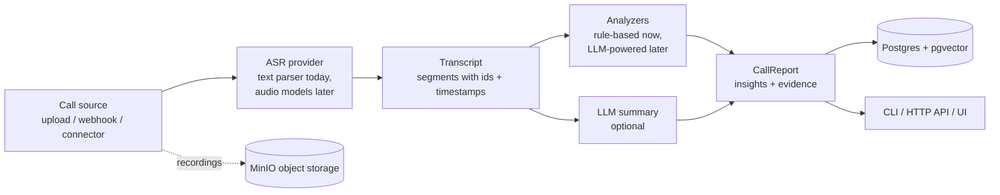

# Architecture

## Flow

Solid boxes up to `CallReport` and the CLI/API exist today. Postgres, MinIO and the UI are
provisioned or planned but not yet connected.

## Design decisions

1. **Every insight carries evidence.** An `Insight` points to the transcript segments
   (id, timestamp, speaker, quote) that justify it. This makes output auditable and gives
   the planned UI click-to-jump behaviour. Analyzers that cannot cite evidence should not
   emit high-severity insights.
2. **Plugin interfaces over hard dependencies.** ASR, LLM and analyzers are `Protocol`s
   registered by name. Swapping a local model for a hosted one, or adding a sector-specific
   analyzer, does not touch the pipeline.
3. **Zero-dependency core.** Parsing, analyzers, pipeline and CLI use only the standard
   library, so the analysis logic is easy to test, embed and audit. FastAPI is needed only
   to serve HTTP.
4. **A failing model must not lose results.** If the LLM call fails, the report still ships
   with the rule-based insights and a deterministic summary.
5. **Rule-based baseline first.** LLM analyzers will be measured against it on labelled
   transcripts before they replace it.

## Data model (`db/schema.sql`)

`calls` 1—n `segments` (ordered turns) and 1—n `insights` (kind, severity, title, detail,
evidence as JSON). The pgvector extension is enabled for planned semantic search; no
embedding column is defined yet because the dimension depends on the chosen model.

## Deployment

`docker-compose.yml` runs Postgres+pgvector, MinIO, the API, and an optional Ollama
container behind the `local-llm` profile. Default passwords are for local development only.
