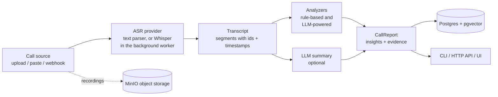

# Architecture

## Flow

Everything in the diagram exists. Recordings are stored in MinIO and processed by a separate
worker that claims jobs from Postgres; text is analyzed inside the request. Every stored row
belongs to an organization, and every API query filters by it.

## Design decisions

1. **Every insight carries evidence.** An `Insight` points to the transcript segments
   (id, timestamp, speaker, quote) that justify it. This makes output auditable and gives
   the planned UI click-to-jump behaviour. Analyzers that cannot cite evidence should not
   emit high-severity insights.
2. **Plugin interfaces over hard dependencies.** ASR, LLM and analyzers are `Protocol`s
   registered by name. Swapping a local model for a hosted one, or adding a sector-specific
   analyzer, does not touch the pipeline.
3. **Zero-dependency core.** Parsing, analyzers, pipeline and CLI use only the standard
   library, so the analysis logic is easy to test, embed and audit. FastAPI is needed only
   to serve HTTP.
4. **A failing model must not lose results.** If the LLM call fails, the report still ships
   with the rule-based insights and a deterministic summary.
5. **Rule-based baseline first.** LLM analyzers will be measured against it on labelled
   transcripts before they replace it.

## Data model (`services/api/src/callsight/migrations/`)

`calls` 1—n `segments` (ordered turns) and 1—n `insights` (kind, severity, title, detail,
evidence as JSON). `segment_embeddings` holds one pgvector embedding per segment per model
(no fixed dimension, so switching models needs no migration). Rows cascade with their segment;
the worker fills in missing ones when it has no audio to transcribe, and `GET /v1/search`
ranks an org's lines by cosine distance with an exact scan (no ANN index yet).

Schema changes are numbered SQL files in that folder (`0001_initial.sql`, ...). The API and the
worker apply any pending ones at startup, under a Postgres advisory lock, and record them in
`schema_migrations`. Never edit an applied file; add the next number. Manual run:
`python -m callsight.migrate`.

## Deployment

`docker-compose.yml` runs Postgres+pgvector, MinIO, the API, and an optional Ollama
container behind the `local-llm` profile. Default passwords are for local development only.
